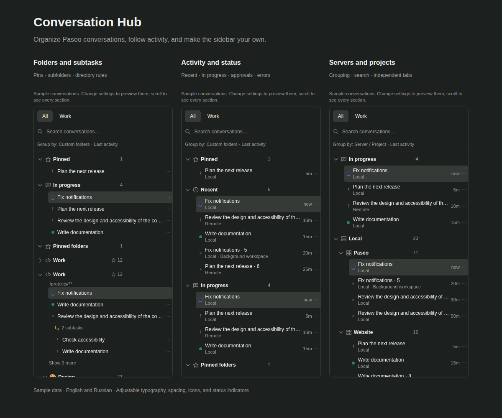
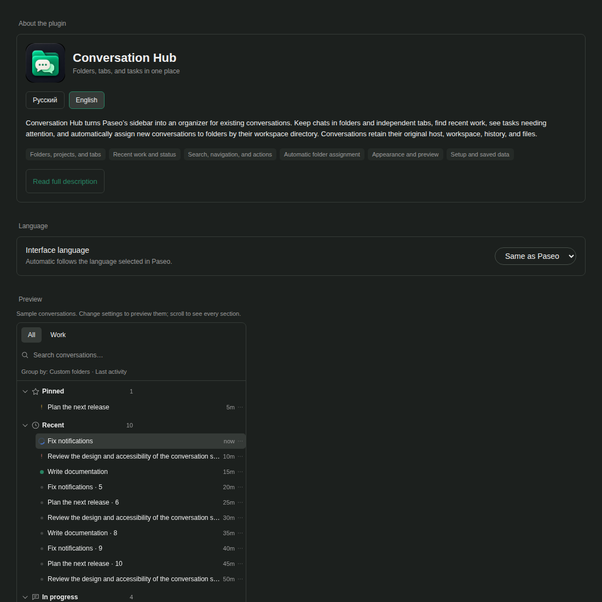
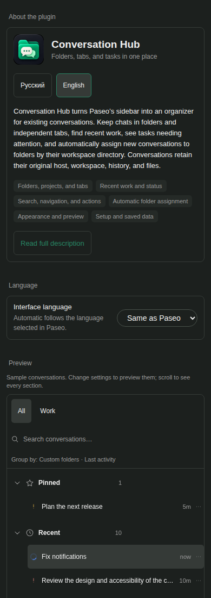

<p align="center">
  
</p>

# Conversation Hub for Paseo

**English** · [Русский](README.ru.md)

Organize Paseo conversations with folders, independent tabs, pinned and recent chats, workspace directory rules, and a sidebar you can customize.

Conversation Hub is based on **[Conversation folders Plus by xiaobaifly7](https://paseo.sh/plugins/xiaobaifly7/conversation-folders-plus)** ([source](https://github.com/xiaobaifly7/paseo-conversation-folders)), which builds on [Conversation folders by Cocean001](https://github.com/Cocean001/paseo-conversation-folders). Original MIT copyright notices and Git history are preserved.



## Features

| Area | What you can do |
| --- | --- |
| Folders | Create folders and subfolders; edit names, icons, emojis, colors, and pins; move chats with drag and drop. |
| Tabs | Create independent views of selected conversations with their own folder structures. Close and reopen tabs without losing their contents. |
| Shortcuts | Keep chats and folders pinned while retaining their original placement. Revisit recent chats with a configurable limit. |
| Activity | See running tasks, approval requests, errors, unread updates, and folded subtasks. Choose among five running indicators. |
| Search | Search titles and filter by status, host, project, and labels. Hand off full-history searches to Transcript Search when installed. |
| Grouping and order | Group by folders, projects, servers, or servers with projects. Sort folders independently of conversations. |
| Automation | Assign new conversations by workspace directory or `*` / `**` patterns; optionally include nested paths, Git worktrees, and subprocesses. |
| Appearance | Adjust font size, row height, group spacing, indentation, title lines, icons, counts, status marks, and timestamps. Test changes in an interactive preview. |
| Languages | Use Russian or English, or follow Paseo. The original Simplified Chinese translations remain available. |

The open chat can reveal itself in the sidebar without taking focus from the composer. Context menus provide available rename, pin, label, copy, archive, and delete actions. Archive and deletion require confirmation.

Read the [full English overview](OVERVIEW.md) or [Russian overview](OVERVIEW.ru.md) for detailed behavior and limitations.

## Screenshots

### Description and appearance settings

The installed settings screen includes the plugin icon, English/Russian descriptions, and the interactive sidebar preview. All images below use sample conversations.



### Compact layout



The [Russian README](README.ru.md) includes the same screens in Russian.

## Install from GitHub

Requires **Paseo `>=0.17.3 <0.18.0`** on the daemon and clients. Install the plugin on the daemon that owns your conversations:

```sh
paseo plugin add git:web-ant/Conversation-Hub-Paseo
```

Select **Conversation Hub** in **Settings → Sidebar → Sidebar view** on each device. Open **Settings → Plugins → Conversation Hub** for appearance, language, automatic assignment, and the full description.

The runtime ID remains **`conversation-folders-plus`** for compatibility with existing folder settings and routing. The display name is **Conversation Hub**. This fork and the original plugin should not be installed under that same ID at the same time.

## Registry listing and the list icon

The registry submission is being prepared. Direct Git installation works before the listing is approved. The registry ID and install command will be added here after publication.

In current Paseo versions, the plugin-list icon and top-page icon come from the registry listing. Direct Git or local installation can show the default initial in those positions; the custom icon is already visible inside the plugin’s settings. After approval, install through the published registry entry for its listing icon and translated listing text. No changes to Paseo source code are needed.

## Existing local installations

Do not remove your existing installation to switch sources: removing a plugin also removes its saved settings. Keep the local installation while the registry listing is reviewed. Updating the source and preserving settings should be handled separately after publication.

## Data and permissions

- Folder structure, memberships, pins, tabs, project appearance, and assignment rules are stored on the Paseo host. Appearance and expansion state are stored per device.
- Chats retain their original hosts, workspaces, histories, and files. Folder assignment does not move directories.
- The backend uses the local daemon’s `paseo.pid` and `local-credential` to connect to that same daemon for settings updates and conversation rename. It does not send this credential to an external service.
- Git worktree matching may run a local `git rev-parse`. Permanent deletion uses the local Paseo CLI and requires confirmation. The plugin does not download software while running or send organization data to an external service.

See the [overview](OVERVIEW.md#setup-and-saved-data) for the complete storage and access description.

## Development

Use Node.js 24 or newer for the checks below:

```sh
git clone https://github.com/web-ant/Conversation-Hub-Paseo.git
cd Conversation-Hub-Paseo
npm ci
npm run sync-info
npm run typecheck
npm test
npm pack --dry-run --ignore-scripts
```

`npm run sync-info` embeds the current PNG icon and English/Russian overviews in the settings UI. Run it after changing the icon, name, or either overview. The generated modules are committed, so users need no separate build step.

For local development, typecheck first, then reload the existing runtime ID:

```sh
paseo plugin reload conversation-folders-plus
```

## Limitations

Touch dragging has been checked with browser touch emulation; physical-phone and simultaneous multi-host acceptance remain incomplete. Rename and permanent deletion are restricted to the plugin’s own host. Manual mark-as-unread and opening a file manager are unavailable through the supported API. See [all limitations](OVERVIEW.md#limitations).

## Credits and license

- Based on [Conversation folders Plus](https://paseo.sh/plugins/xiaobaifly7/conversation-folders-plus) by **xiaobaifly7**.
- Original [Conversation folders](https://github.com/Cocean001/paseo-conversation-folders) by **Cocean001**.
- Conversation Hub additions are maintained in [web-ant/Conversation-Hub-Paseo](https://github.com/web-ant/Conversation-Hub-Paseo).

[MIT license](LICENSE). Upstream attribution is retained.
