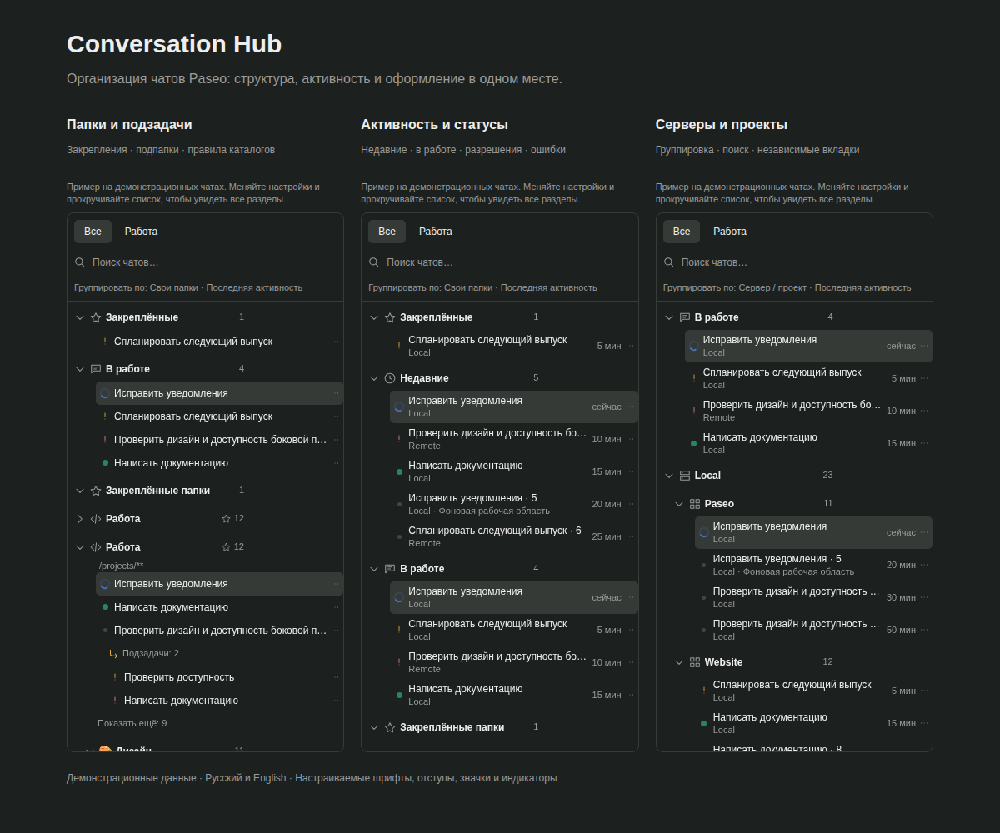
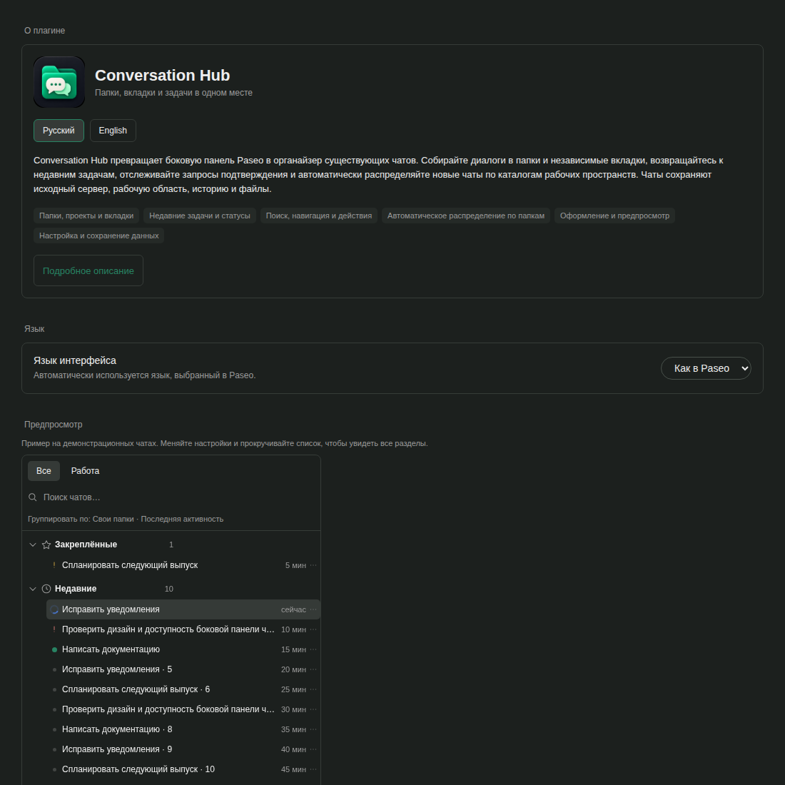
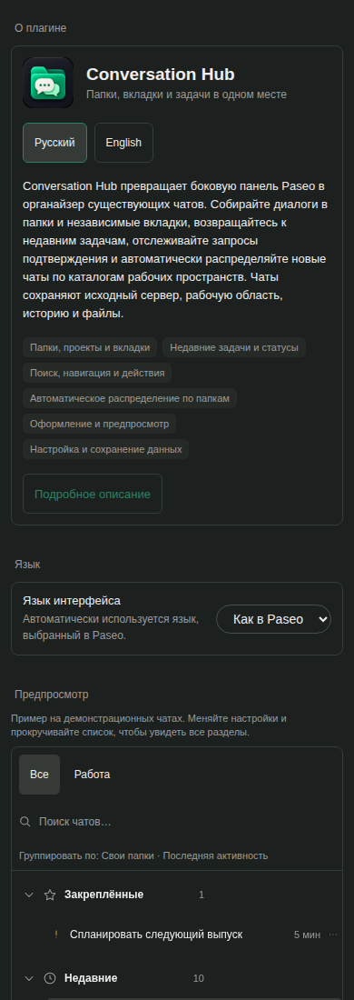

<p align="center">
  
</p>

# Conversation Hub для Paseo

[English](README.md) · **Русский**

Организуйте чаты Paseo с помощью папок, независимых вкладок, закреплённых и недавних задач, правил каталогов и настраиваемой боковой панели.

Conversation Hub основан на **[Conversation folders Plus от xiaobaifly7](https://paseo.sh/plugins/xiaobaifly7/conversation-folders-plus)** ([исходники](https://github.com/xiaobaifly7/paseo-conversation-folders)), который развивает [Conversation folders от Cocean001](https://github.com/Cocean001/paseo-conversation-folders). Исходные уведомления об авторских правах MIT и авторство разработчиков сохранены.



## Возможности

| Раздел | Что можно делать |
| --- | --- |
| Папки | Создавать папки и подпапки, менять названия, значки, эмодзи, цвета и закрепления; переносить чаты перетаскиванием. |
| Вкладки | Создавать независимые представления выбранных чатов со своей структурой папок. Закрывать и возвращать вкладки без потери содержимого. |
| Быстрый доступ | Закреплять чаты и папки, сохраняя исходное размещение. Возвращаться к недавним чатам с настраиваемым лимитом. |
| Активность | Видеть выполнение, запросы подтверждения, ошибки, непрочитанные обновления и свёрнутые подзадачи. Выбирать один из пяти индикаторов выполнения. |
| Поиск | Искать по названиям и фильтровать по статусу, серверу, проекту и меткам. Переходить к полнотекстовому поиску при установленном Transcript Search. |
| Группировка и порядок | Группировать по папкам, проектам, серверам и серверам с проектами. Сортировать папки независимо от чатов. |
| Автоматизация | Распределять новые чаты по каталогам рабочих пространств и шаблонам `*` / `**`; учитывать вложенные пути, Git worktree и подпроцессы. |
| Оформление | Настраивать шрифт, высоту строк, расстояния, отступы, строки заголовков, значки, счётчики, статусы и время активности. Проверять изменения в интерактивном предпросмотре. |
| Языки | Использовать русский или английский либо следовать языку Paseo. Унаследованные переводы на упрощённый китайский сохранены. |

Открытый чат может автоматически показываться в боковой панели, сохраняя фокус в поле сообщения. Контекстные меню содержат доступные действия переименования, закрепления, меток, копирования, архивирования и удаления. Архивирование и удаление требуют подтверждения.

Подробности поведения и ограничений: [полный обзор на русском](OVERVIEW.ru.md) и [на английском](OVERVIEW.md).

## Скриншоты

### Описание и настройки оформления

В настройках установленного плагина доступны иконка, описания на русском и английском и интерактивный предпросмотр боковой панели. На скриншотах используются демонстрационные чаты.



### Компактный экран



Английские варианты экранов находятся в [English README](README.md).

## Установка с GitHub

Требуется **Paseo `>=0.17.3 <0.18.0`** на сервере и клиентах. Установите плагин на сервере, которому принадлежат чаты:

```sh
paseo plugin add git:web-ant/Conversation-Hub-Paseo
```

На каждом устройстве выберите **Conversation Hub** в **Настройки → Боковая панель → Вид боковой панели**. В **Настройки → Плагины → Conversation Hub** находятся оформление, язык, автоматическое распределение и полное описание.

Технический ID — **`conversation-hub`**, отображаемое название — **Conversation Hub**. Версия 0.3.1 использует новый ID для новых установок.

## Реестр и иконка в списке плагинов

Заявка в реестр создана: [issue #3432](https://github.com/getpaseo/plugins/issues/3432), [PR проверки #3433](https://github.com/getpaseo/plugins/pull/3433). Прямая установка с GitHub работает до одобрения записи. ID реестра и команду установки добавим после публикации.

В текущих версиях Paseo значки в общем списке плагинов и верхней части страницы берутся из записи реестра. При установке напрямую с GitHub или из локального каталога там может отображаться стандартная буква; внутри настроек уже доступна собственная иконка. После одобрения установите плагин через опубликованную запись реестра, чтобы использовать её значок и переводы карточки. Изменения исходников Paseo не требуются.

## Если плагин уже установлен локально

Если ваша установка использует `conversation-folders-plus`, сохраните её и исходную папку без изменений до проверенного переноса настроек. Paseo хранит настройки под ID установки: установка `conversation-hub` сама по себе не переносит папки, вкладки, закрепления и правила. Оформление, состояние раскрытия и выбранное представление боковой панели также хранятся отдельно на каждом устройстве. Не удаляйте старый плагин и не включайте обе копии для переноса.

Эта версия меняет ID по умолчанию для новых установок. Она не переименовывает действующие установки и не переносит настройки автоматически. До переключения существующей установки сохраните резервную копию настроек сервера и каждого устройства.

## Данные и доступ

- Структура папок, состав чатов, закрепления, вкладки, оформление проектов и правила распределения хранятся на сервере Paseo. Оформление и раскрытие веток — на устройстве.
- Чаты сохраняют исходные серверы, рабочие области, историю и файлы. Распределение по папкам не перемещает каталоги.
- Для изменения настроек и переименования чатов backend использует `paseo.pid` и `local-credential` локального демона, подключаясь к этому же демону. Учётные данные не отправляются во внешний сервис.
- Сопоставление Git worktree может запускать локальный `git rev-parse`. Безвозвратное удаление использует CLI Paseo и требует подтверждения. Плагин не загружает программы во время работы и не отправляет данные организации чатов во внешние сервисы.

Полное описание хранения и доступа: [обзор](OVERVIEW.ru.md#настройка-и-сохранение-данных).

## Разработка

Для проверок ниже используйте Node.js 24 или новее:

```sh
git clone https://github.com/web-ant/Conversation-Hub-Paseo.git
cd Conversation-Hub-Paseo
npm ci
npm run sync-info
npm run typecheck
npm test
npm pack --dry-run --ignore-scripts
```

`npm run sync-info` встраивает актуальную PNG-иконку и тексты OVERVIEW на русском и английском в настройки плагина. Запускайте команду после изменения иконки, названия или обзоров. Сгенерированные модули включены в репозиторий, поэтому пользователям не нужна отдельная сборка.

При локальной разработке сначала проверьте типы, затем перезагрузите существующий ID:

```sh
paseo plugin reload conversation-hub
```

## Ограничения

Сенсорное перетаскивание проверено эмуляцией касаний в браузере; приёмка на физических телефонах и одновременно на нескольких реальных серверах ещё не завершена. Переименование и безвозвратное удаление доступны только для сервера установки плагина. Ручная отметка непрочитанным и открытие файлового менеджера недоступны через поддерживаемый API. См. [полный список ограничений](OVERVIEW.ru.md#ограничения).

## Благодарности и лицензия

- Основан на [Conversation folders Plus](https://paseo.sh/plugins/xiaobaifly7/conversation-folders-plus) от **xiaobaifly7**.
- Исходный [Conversation folders](https://github.com/Cocean001/paseo-conversation-folders) — **Cocean001**.
- Дополнения Conversation Hub развиваются в [web-ant/Conversation-Hub-Paseo](https://github.com/web-ant/Conversation-Hub-Paseo).

[Лицензия MIT](LICENSE). Атрибуция исходных авторов сохранена.
